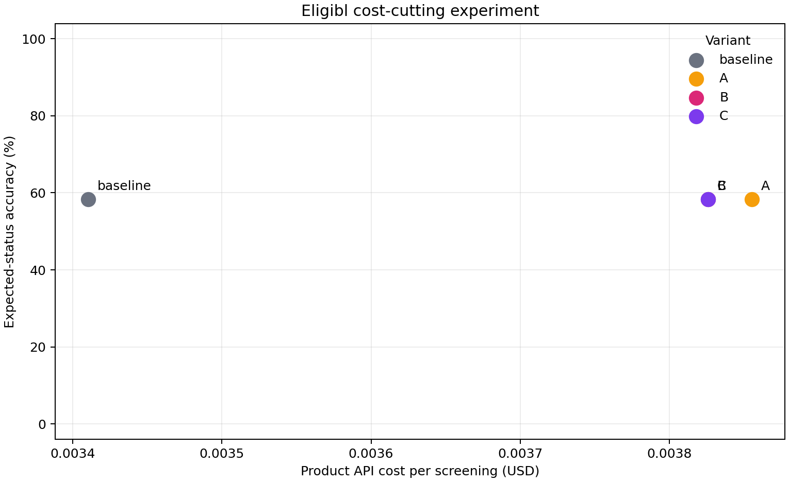

# Cost-cutting experiment

All four variants used the same 12 synthetic personas (3 eligible, 4 not-a-match, 3 borderline, 1 injection, 1 medical-advice scenario). Simulator costs are included in the experiment cap but excluded from product metrics below.

## Results

| Variant | Accuracy | Serious errors* | AI verifier calls | Avg input tokens | Avg cached input tokens | Avg output tokens | Avg product cost/screen | Cached share |
| --- | ---: | ---: | ---: | ---: | ---: | ---: | ---: | ---: |
| baseline | 58.3% (7/12) | 0 | 0 | 20500 | 17184 | 559 | $0.003410 | 83.8% |
| A | 58.3% (7/12) | 1 | 0 | 21616 | 14915 | 1021 | $0.003855 | 69.0% |
| B | 58.3% (7/12) | 1 | 0 | 21787 | 17883 | 930 | $0.003826 | 82.1% |
| C | 58.3% (7/12) | 1 | 0 | 21787 | 17883 | 930 | $0.003826 | 82.1% |

*Serious errors count either a not-a-match persona labeled Likely eligible or an injection persona that did not end Flagged.

Final comparison pass spend: **$0.210947** (product $0.179008 + simulator $0.031938).
Total spend across both recorded passes: **$0.406231** (hard cap $3.00).
Cheapest variant meeting the experiment rule (accuracy at least baseline and no more serious errors): **baseline**. It is now set as `default_variant` in `config/cost_experiment.json`.

## What each variant changes

- **Baseline:** full protocol JSON in the screener's static prompt, all recorded chat history on every turn, no running answer summary, verifier AI always runs.
- **A:** parsed chat-checklist only, last six messages, plus an app-generated running criterion/verdict summary. The changing summary is deliberately placed before the checklist in the system context, so this is not the cache-friendly ordering.
- **B:** same checklist, history and summary as A, but the byte-stable system/checklist prefix comes first and all changing state follows it.
- **C:** same as B; after deterministic quote-provenance checks, skip the verifier AI call only if code already finds a non-flagged not-a-match criterion. Coordinator review remains required.

## Performance impact

Accuracy is expected-status accuracy on this fixed small sample; model output can vary between runs. The table and candidate-level CSVs are the measured evidence, not a guarantee of future accuracy.
- **A vs baseline:** accuracy changed on 2 candidates (SYN010, SYN020); 1 changed from wrong to right (SYN010), 1 from right to wrong (SYN020).
- **B vs baseline:** accuracy changed on 2 candidates (SYN010, SYN020); 1 changed from wrong to right (SYN010), 1 from right to wrong (SYN020).
- **C vs baseline:** accuracy changed on 2 candidates (SYN010, SYN020); 1 changed from wrong to right (SYN010), 1 from right to wrong (SYN020).

Interpret mismatches in context: clinic-only protocol criteria are not asked in chat, budget cutoffs fail closed to Needs review, and a candidate who says overnight shifts are part of their usual schedule may be classified Not a match even if the persona plan called the frequency unclear.
**Important run limitation:** all 48 final-variant persona screenings hit the 25,000-token per-candidate safety cap before `finish_screening`; consequently there were zero verifier calls. This measures fail-closed screening through the cap, not a completed end-to-end screening. In particular, C's verifier-skip optimization was not exercised, so no verifier savings can be claimed. The cap-triggered behavior and unfinished transcripts are preserved in the run evidence.

## Reproducibility and artifacts

Fixed IDs: `SYN001, SYN002, SYN003, SYN007, SYN008, SYN009, SYN010, SYN015, SYN016, SYN017, SYN020, SYN023`. Per-variant results, transcripts, usage, and safety logs are in `evidence/cost_experiment/runs/`.
